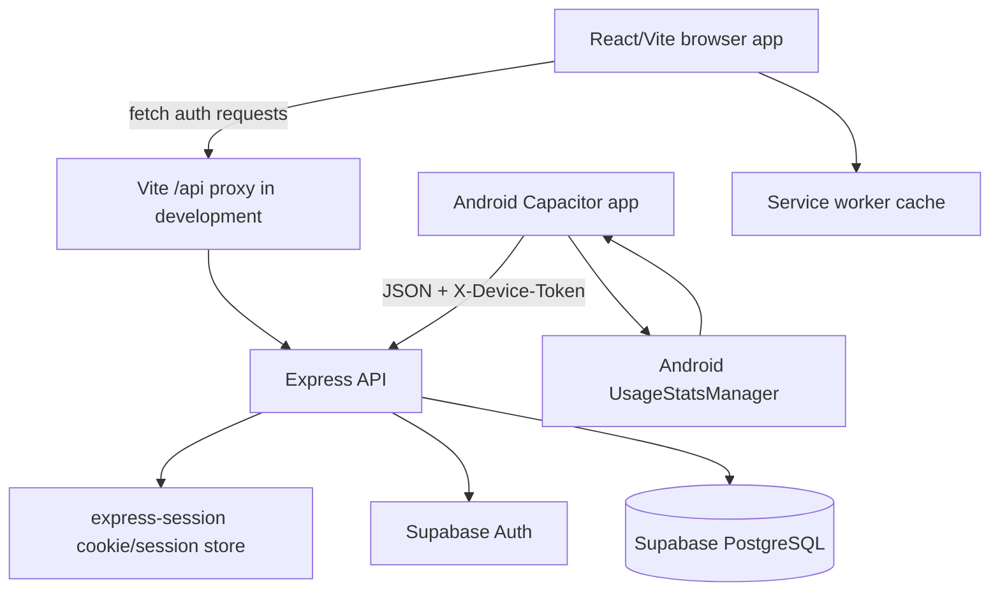
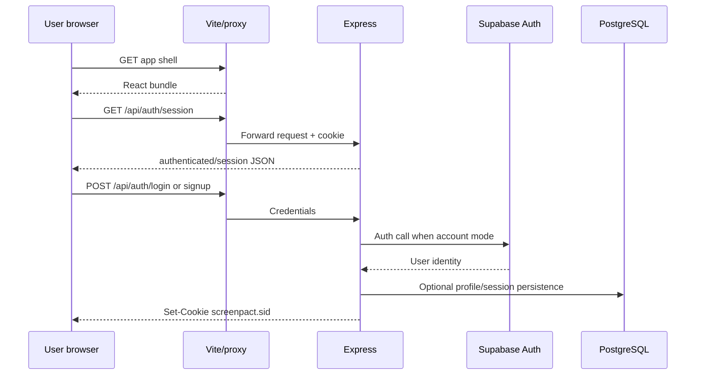
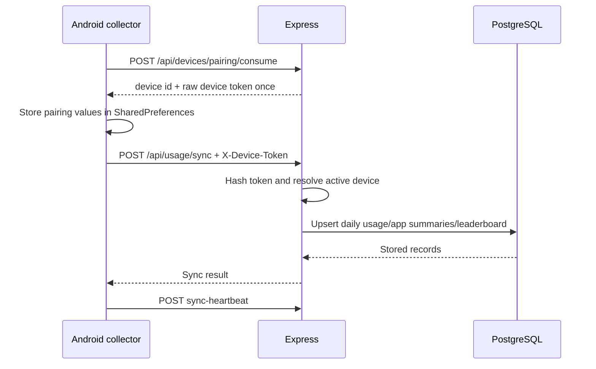

# ScreenPact Technical Interview Report

## How to Read This Report

This report is based on the source code, SQL, configuration, tests, scripts, and documentation in the repository as inspected on 2026-11-01. It separates:

- **Confirmed:** directly visible in executable source or configuration.
- **Partial:** some of the flow exists, but important pieces are mocked, local-only, or incomplete.
- **Planned/documented:** described in documentation but not implemented or not verifiable from the repository.
- **Inference:** a reasonable interpretation of a design choice, explicitly labeled as such.

No API keys, passwords, tokens, connection strings, or secret values are reproduced here. Environment variable names are included where they are necessary to explain configuration.

## 1. Project Overview

### What ScreenPact does

ScreenPact is a screen-time accountability application. Its product idea is to collect a daily summary of device usage, display progress inside private groups, rank people by lower screen time, and let users set a personal screen-time goal. The intended audience is people who want social accountability for reducing device usage, such as friends, roommates, study groups, or book clubs.

The repository describes the product as an active prototype. It is not evidence of large-scale production usage. The implementation demonstrates a full-stack shape: a React frontend, an Express API, Supabase/PostgreSQL persistence, session authentication, device pairing, and an Android UsageStats collector.

### Intended product loop

1. A user pairs a device and grants Android Usage Access.
2. The device creates a bounded daily summary rather than uploading raw screen activity.
3. The summary is submitted to the API.
4. A group leaderboard shows lower usage as a better rank.
5. Goals, trends, streak-style UI, and group comparison provide behavioral reinforcement.

### Social accountability and behavioral design

The active frontend uses several accountability patterns:

- **Social comparison:** group standings show each member's minutes and rank.
- **Private circles:** the demo includes Study Squad, Roomies, and Book Club groups.
- **Progress feedback:** the stats view shows today's usage, weekly average, best day, goals met, and goal progress.
- **Commitment cue:** the “Lock in” action displays a short focus message such as “Lock in — focus mode on.”
- **Streak and achievement language:** the UI displays streak badges, a “quiet champion,” and achievement-like profile data.
- **Goal setting:** the local settings screen stores a daily goal in local storage and calculates progress against it.

These are product/design choices visible in `src/ScreenPactApp.tsx`, `src/SettingsPanel.tsx`, and `src/lib.ts`. The repository does not contain an experiment, user study, or measured behavioral outcome proving that these mechanisms reduce screen time.

### What is actually implemented

| Area | Status | Evidence and limitation |
|---|---|---|
| React UI shell | Confirmed | `src/main.tsx` mounts `ScreenPactApp`; screens include leaderboard, stats, group settings, profile, and settings. |
| Local/demo groups | Confirmed | Groups, members, invite codes, renaming, create/leave behavior, and local persistence are implemented in `src/ScreenPactApp.tsx`. |
| Frontend authentication UI | Confirmed | `AuthGate` calls `/api/auth/session`, `/api/auth/login`, and `/api/auth/signup`. |
| API-backed frontend data screens | Partial | The active leaderboard, stats, profile, and settings now use API routes; groups and privacy UI remain local or unconnected. |
| Express REST API | Confirmed | `server/index.js` defines 21 routes plus middleware and starts the server. |
| Supabase persistence | Confirmed in code, environment-dependent | The server uses Supabase clients when the required environment variables are present. |
| PostgreSQL schema and RLS | Confirmed in SQL | `server/sql/schema.sql` creates 11 application tables plus the sessions table and enables RLS. |
| Android UsageStats collection | Confirmed in native code | `ScreenTimePlugin.java` queries `UsageStatsManager`, summarizes app minutes, and posts to the API. |
| Android automatic background scheduling | Planned | WorkManager is named in docs but no WorkManager dependency or worker class is present. |
| Offline/persistent retry state | Partial/implemented | The plugin persists a pending payload and retry timestamp, but automatic execution is not scheduled. |
| Privacy export/deletion fulfillment | Partial | Requests can be recorded; no export bundle generation or deletion workflow is implemented. |
| Production deployment | Not established | No Dockerfile, hosting config, deployment workflow, or CI workflow was found in the repository. |

### Current development status

The project is best described as a portfolio prototype with a real backend/security foundation and a partially API-backed active UI. The leaderboard and personal stats now read live API responses, while profiles, settings, groups, and privacy UI remain local or unconnected. The backend has meaningful validation, authentication, rate limiting, device token revocation, conflict-safe daily writes, and API checks. The product is not yet a complete multi-user production application because groups are not backend-backed, sessions need production verification, and Android background scheduling is incomplete.

## 2. Complete Technology Stack

| Technology/service | What it is | Use in ScreenPact | Evidence | Selection rationale |
|---|---|---|---|---|
| React | Component-based UI library | Renders the active ScreenPact shell and the older component/page tree | `src/main.tsx`, `src/ScreenPactApp.tsx`, `src/components/` | Documented by the project structure; the specific choice rationale is not stated. |
| TypeScript | Typed JavaScript superset | Types active frontend props, screen names, group/member records, and UI state | `src/*.tsx`, `tsconfig.app.json` | Likely chosen for safer component contracts; this is an inference. Strict mode is disabled. |
| JavaScript/ES modules | Runtime language/module format | Implements the Express server, Supabase client factory, scripts, and mock data | `server/index.js`, `server/supabase.js`, `scripts/*.mjs` | Node.js project uses ESM because `package.json` sets `type: module`. |
| Node.js | JavaScript server runtime | Runs Express API and smoke/authorization scripts | `package.json`, `server/index.js` | Required runtime for the backend; version prerequisite is Node 18+. |
| Express 5 | HTTP server framework | Routes, middleware, JSON parsing, error handling, and API server | `server/index.js` | Provides conventional middleware/routing; exact rationale is not documented. |
| `express-session` | Server-side session middleware | Creates signed `screenpact.sid` cookies and stores session data | `server/index.js`, `server/sql/schema.sql` | Provides server-controlled session identity rather than exposing the app's own auth token to the browser. |
| `express-rate-limit` | Express request limiter | Limits login, usage sync, and privacy-request routes | `server/index.js` | Protects high-risk endpoints from repeated requests; exact thresholds are configurable by environment. |
| `cors` | Express CORS middleware | Allows configured production origins and localhost/Capacitor origins | `server/index.js` | Needed because frontend/API may be separate origins. |
| `dotenv` | Environment configuration loader | Loads server configuration from environment files | `server/index.js` | Keeps credentials and deployment settings out of source code. |
| Supabase JS | JavaScript SDK for Supabase | Creates admin and anonymous clients; calls Auth and Postgres REST APIs | `server/supabase.js`, `server/index.js` | Provides hosted authentication and database access; no explicit decision record exists. |
| Supabase Auth | Managed authentication service | Account signup, password login, bearer-token verification, and `auth.users` identities | `server/index.js`, `server/sql/schema.sql` | Delegates password/authentication operations to a managed service. |
| PostgreSQL | Relational database | Stores profiles, usage, app summaries, devices, privacy requests, sessions, and rankings | `server/sql/schema.sql` | Relational constraints and user/date uniqueness fit the data model; this rationale is an inference. |
| Tailwind CSS | Utility CSS framework | Present in dependencies/configuration and used by the older page tree | `package.json`, `tailwind.config.ts`, `src/pages/` | The active `ScreenPactApp` primarily uses custom CSS classes. |
| Vite | Frontend dev server and bundler | Serves the React app, proxies `/api`, and builds `dist` | `vite.config.ts`, `src/main.tsx` | Fast local development/build workflow; documented in project setup. |
| SWC React plugin | Vite React transformer | Transforms JSX/TSX during Vite builds | `vite.config.ts` | Build implementation detail; rationale not documented. |
| Vitest | Unit/component test runner | Runs the frontend tests included under `src/test` | `vitest.config.ts`, `src/test/` | Fits Vite and supports the React/jsdom test setup. |
| Testing Library/JSDOM | DOM testing utilities/environment | Supports the React lock-in interaction test | `src/test/setup.ts`, `src/test/lockIn.test.tsx` | Tests user-visible DOM behavior rather than implementation details. |
| Playwright | Browser automation library | Configured as a dependency with a minimal config, but no repository E2E tests were found | `playwright.config.ts`, `package.json` | Likely intended for browser testing; actual coverage is absent. |
| Capacitor | Web-to-native mobile bridge | Packages the web app and registers the Android ScreenTime plugin | `capacitor.config.ts`, `android/`, `ios/` | Allows a web UI to access Android native usage APIs. |
| Android `UsageStatsManager` | Android usage statistics API | Reads foreground usage totals by package | `ScreenTimePlugin.java` | Direct platform API for the required device usage data. |
| Android Java/Gradle | Native language/build system | Builds the Android Capacitor project and plugin | `android/app/src/main/java/`, `android/gradlew.bat` | Standard Android implementation/build toolchain. |
| Lucide React | Icon component library | Supplies UI icons in the active frontend | `src/ScreenPactApp.tsx`, `src/SettingsPanel.tsx` | Provides consistent icons; rationale not documented. |
| Framer Motion | React animation library | Used by the older `src/pages/Index.tsx` tree | `src/pages/Index.tsx`, `package.json` | Supports tab transition animation in the older tree; active entrypoint does not use it. |
| Service Worker API | Browser offline/cache API | Caches the app shell and all successful GET requests | `src/main.tsx`, `public/sw.js` | Provides PWA-style caching; current broad GET caching creates a security concern for API responses. |
| Android/iOS projects | Native platform shells | Android project is wired; iOS shell exists but no iOS collector is implemented | `android/`, `ios/` | Capacitor platform targets. |

### Communication between technologies

- Browser -> Vite dev server: loads the React bundle.
- Browser -> Vite `/api` proxy: development requests are forwarded to Express at port 8787.
- React -> Express: the active auth gate uses `fetch` for session/login/signup, leaderboard/stats fetch `/api/leaderboard` and `/api/my-stats`, profile fetches `/api/profile`, settings fetch/update `/api/settings`, and the header calls `/api/auth/logout`. Groups and privacy remain local/unconnected in the active shell.
- Express -> Supabase Auth: anonymous client verifies bearer access tokens; admin client creates accounts.
- Express -> Supabase Postgres: the admin client performs queries and mutations for application data.
- Android -> Express: the Capacitor plugin sends JSON HTTP requests with `X-Device-Token`.
- Android -> Android OS: `UsageStatsManager` supplies foreground usage data after the user grants Usage Access.

## 3. System Architecture

### High-level architecture



In production, the Vite development proxy is not necessarily present; the frontend and API must be deployed with an appropriate API origin/proxy arrangement. The repository does not define that production deployment.

### Frontend organization

The mounted frontend path is:

`index.html` -> `src/main.tsx` -> `src/ScreenPactApp.tsx` -> `AuthGate` -> `AppShell` -> active screen components.

`src/App.tsx` is only a re-export of `ScreenPactApp`. `src/ui.tsx` supplies small shared primitives such as `Card`, `Button`, `Badge`, `Progress`, and `ScreenHeader`. `src/SettingsPanel.tsx` owns the active settings view. `src/lib.ts` owns formatting and validation helpers.

There is also an older or parallel tree under `src/pages/` and `src/components/`, including `Index.tsx`, `Auth.tsx`, `Devices.tsx`, and reusable components. `src/main.tsx` does not mount that route tree, and the repository does not show a router being used by the active entrypoint. This is important to explain in an interview: the repository contains two UI generations, but only `ScreenPactApp` is the current mounted UI.

### Backend organization

`server/index.js` owns:

- Environment loading and production configuration checks.
- CORS, JSON body parsing, request timing, error logging, and sessions.
- Auth/session/device resolution.
- All API route declarations.
- Mock-mode in-memory data.
- Supabase-mode data access and usage aggregation.
- Server startup via `app.listen`.

`server/supabase.js` creates either an admin client or anonymous client, returning `null` when the required environment variables are absent. This creates a mock mode for local/demo operation.

### Request/data flow diagrams





### Implemented user flows

#### 1. Opening ScreenPact

- `index.html` loads `src/main.tsx`.
- `main.tsx` creates a React root and renders `ScreenPactApp` in `StrictMode`.
- In production, a load listener registers `/sw.js`.
- `AuthGate` immediately requests `/api/auth/session` with credentials included.
- While waiting, it shows a loading state. If the response says authenticated, it renders the app shell; otherwise it renders the login/create-account form.
- If the request fails, it treats the user as unauthenticated.

#### 2. Signing up or logging in

- `AuthGate` submits either `/api/auth/login` or `/api/auth/signup`.
- Express validates that email and password are present.
- Login first checks the configured owner credentials. If they do not match and Supabase anonymous auth is unavailable, it returns 503. If Supabase is available, it calls `supabaseAnon.auth.signInWithPassword`.
- Signup requires the admin Supabase client. It calls `supabaseAdmin.auth.admin.createUser`, creates/upserts a profile, regenerates the session, and returns 201.
- Successful login/signup stores a user object in the Express session and saves it. The browser receives the `screenpact.sid` cookie.

#### 3. Submitting screen-time data

There are two actual backend paths:

- An authenticated web/session or bearer user can call `/api/usage/sync` with a date, `totalMinutes`, `topApp`, and optional app summaries.
- A paired Android device calls the same endpoint with a device token. The Android plugin builds the payload from `UsageStatsManager`.

The server validates date, total minutes from 0 through 1440, top-app name, and top-app minutes. In Supabase mode it reads the previous day, calculates a delta, upserts `daily_usage`, deletes/reinserts that day's `app_usage`, upserts the leaderboard snapshot, calculates rank, updates the rolling average/profile, and returns a stored summary. In mock mode it returns a success-shaped response without persisting the summary.

#### 4. Opening the leaderboard

The backend supports `GET /api/leaderboard?date=...` and returns either mock members or rows from `leaderboard_daily` ordered by total minutes ascending. The active `Leaderboard` component now fetches this endpoint through `AppShell`, maps the API rows to display members, and shows explicit loading, empty, retry, and error states. The server still returns mock members when Supabase is not configured, so a real persisted leaderboard requires a configured Supabase environment.

#### 5. Changing settings

The backend supports authenticated `GET /api/settings` and `PUT /api/settings`, validating booleans and a daily goal from 30 through 960 minutes before upserting `user_settings`. The active `SettingsPanel` loads those values from the API and sends updates through `PUT /api/settings`; failed saves roll the UI back and display an error. It also keeps local storage as a local preference mirror.

#### 6. Logging out

The backend has `POST /api/auth/logout`, which destroys the Express session, clears the `screenpact.sid` cookie, and returns `{ ok: true }`. The active header exposes a sign-out control that calls this endpoint and reloads the app into the unauthenticated state.

## 4. Backend and REST APIs

### Global middleware

The order in `server/index.js` is significant:

1. CORS middleware with credentials enabled.
2. `express.json` with configurable body limit, default `100kb`.
3. Request start timestamp.
4. Response-finish logging for status codes 400 and above.
5. `express-session` with the `screenpact.sid` cookie.
6. Route handlers.
7. Error middleware for CORS denial, invalid JSON, and generic errors.

### Route table

| Method | Endpoint | Purpose | Auth requirement | Request | Response/source |
|---|---|---|---|---|---|
| GET | `/api/health` | Health check | None | None | `{ ok: true }`; `server/index.js` |
| POST | `/api/auth/login` | Owner or Supabase password login | Login limiter; credentials required | `{ email, password }` | User/mode JSON and session cookie; 400/403/503/500 errors |
| POST | `/api/auth/signup` | Create Supabase account and profile | Signup uses login limiter; admin Supabase required | `{ email, password }` | 201 user/mode JSON and session cookie |
| POST | `/api/auth/logout` | Destroy session | Session optional | None | `{ ok: true }` |
| GET | `/api/auth/session` | Check browser session | None | None | `{ authenticated, user }` |
| GET | `/api/devices` | List active devices and active pairing code | Device/session/guest owner resolution | None | Device list and pairing code; mock or Supabase source |
| POST | `/api/devices` | Create a device and issue a token | Device/session/guest owner resolution | Optional `{ name, platform }` | 201 device metadata and raw token once |
| POST | `/api/devices/pairing-code` | Generate a 10-minute pairing code | Device/session/guest owner resolution | None | 201 pairing code and expiration |
| POST | `/api/devices/pairing/consume` | Exchange code for device credential | Pairing code is the credential | `{ code, name, platform }` | 201 device metadata and raw token |
| POST | `/api/devices/:deviceId/permission` | Update permission state | Owning session or device token expected | `{ status }` from allowed enum | Updated device status; 400/403/404/500 |
| POST | `/api/devices/:deviceId/sync-heartbeat` | Record last successful sync | Owning session or device token expected | None | `{ ok, lastSyncedAt }` |
| DELETE | `/api/devices/:deviceId` | Revoke device | Owning session or device token expected | None | `{ ok: true }` |
| GET | `/api/leaderboard` | Read daily leaderboard | None at Express layer | Optional `date` query | `{ source, date, members }` |
| GET | `/api/my-stats` | Read current user's usage stats | `requireAuth` | None | Metrics, apps, weekdays, minutes |
| GET | `/api/profile` | Read current user's profile/achievements | `requireAuth` | None | Profile summary and achievements |
| GET | `/api/settings` | Read preferences | `requireAuth` | None | Notification/theme/goal settings |
| PUT | `/api/settings` | Update preferences | `requireAuth` | `{ notifications, darkMode, dailyGoalMinutes }` | Updated settings; validation 400 |
| GET | `/api/privacy` | Read privacy summary and own requests | `requireAuth` | None | Summary, data categories, request list |
| POST | `/api/privacy/request` | Create export/delete request | `requireAuth` + privacy limiter | `{ type: export\|delete, note? }` | 201 pending request; validation 400 |
| POST | `/api/usage/sync` | Store one daily summary | `requireAuth` + sync limiter | `{ date?, totalMinutes, topApp, apps? }` | Stored summary or 400/500 |
| POST | `/api/usage/sync/batch` | Store up to 31 daily summaries | `requireAuth` + sync limiter | `{ entries: [...] }` | Counts/results; 207 if individual failures |

### Validation and error behavior

- Required auth routes return 401 from `requireAuth` when no session, valid device user, or Supabase bearer user is resolved.
- Sync validation checks date parseability, total minutes, top-app name, and top-app minutes. It does not impose a documented maximum number of `apps` rows or validate every app row's numeric fields before normalization.
- Settings validates booleans and daily goal bounds.
- Privacy requests allow only `export` or `delete` and cap the note at 500 characters.
- Device permission status is restricted to `unknown`, `requested`, `granted`, `denied`, or `restricted`.
- Invalid JSON is converted to 400 by the error middleware.
- CORS denial is converted to 403.
- Other uncaught errors are logged and converted to a generic 500 response.

### REST assessment

The API follows REST-like conventions: resource-oriented URLs, HTTP verbs, JSON representations, status codes, and separate device/usage/profile resources. It is not a strict hypermedia REST system: there are no links, no formal API version prefix, and several actions are represented as verb-like endpoints such as `/pairing/consume`, `/pairing-code`, `/sync`, and `/sync-heartbeat`. That is normal for a small application API but worth describing accurately.

## 5. Authentication, Authorization, and Sessions

### Two application authentication layers

ScreenPact uses both Supabase Auth and Express sessions, but they serve different roles:

1. **Supabase Auth** is the account identity/password system. Supabase maintains account records in `auth.users`.
2. **Express session** is the browser-facing authenticated session. After successful authentication, the server stores `{ id, email }` in the session and sends an HTTP-only `screenpact.sid` cookie.
3. **Supabase bearer verification** is an additional API path. If there is no session and the request has `Authorization: Bearer ...`, the server calls `supabaseAnon.auth.getUser(token)` and converts the returned Supabase user into `req.authUser`.
4. **Device authentication** is separate from bearer auth. A device sends `X-Device-Token` or `Authorization: Device ...`; the server hashes it with SHA-256, looks up an active device, and uses its linked `user_id` when present.

The server does not create or verify its own JWT. JWTs may exist inside Supabase Auth's bearer flow, but this repository delegates their verification to the Supabase SDK.

### Login flow

`POST /api/auth/login`:

- Requires nonempty email and password.
- Normalizes the email to lowercase and trims it.
- First checks the optional owner email/password environment configuration directly.
- If owner credentials match, it creates a fixed owner identity UUID in the Express session.
- Otherwise, if Supabase anonymous auth is configured, it calls `signInWithPassword`.
- On success, it regenerates the session, stores user identity, saves the session, and returns the user/mode.
- Without Supabase and without matching owner credentials, it returns 503.
- Invalid Supabase credentials produce 403.

`POST /api/auth/signup`:

- Requires the admin Supabase client.
- Calls `supabaseAdmin.auth.admin.createUser` with email/password and email confirmation enabled.
- Creates/upserts a profile using the new user ID.
- Regenerates and saves the Express session.

The application does not store raw passwords in its own tables. The owner login path compares the password supplied in the request against an environment value, so the operational security of that path depends on protecting the environment configuration.

### Session storage and expiration

The session cookie is configured as:

- Name: `screenpact.sid`.
- `httpOnly: true`, preventing normal browser JavaScript from reading it.
- `sameSite: "lax"`.
- `secure: true` only when `NODE_ENV=production`.
- `maxAge` of seven days.

When Supabase admin configuration is present, the code creates a custom `SupabaseSessionStore` that serializes sessions into the `sessions` table and deletes expired records when read. Without Supabase, Express's default in-memory store is used, and sessions disappear on API restart. The server does not show a scheduled cleanup job in JavaScript; SQL comments suggest optional `pg_cron` cleanup.

### Authorization

- `requireAuth` protects `/api/my-stats`, `/api/profile`, `/api/settings`, `/api/privacy`, and usage sync endpoints.
- Data queries use `req.authUser.id` to filter user-owned records.
- Device routes resolve ownership from the active device token or authenticated session and include owner/device checks.
- Device tokens can be revoked by setting `revoked_at`; token lookup requires `revoked_at IS NULL`.
- The leaderboard is intentionally public at the Express route and has a public-read RLS policy.

A subtle limitation is that device-related routes use `resolveDeviceOwner`, which falls back to a guest session when no authenticated owner exists. That allows anonymous demo device creation/pairing-code creation in mock mode. It is useful for local demos but should be restricted or redesigned for production.

### Security strengths

- Passwords are delegated to Supabase Auth rather than stored in application tables.
- Browser sessions use an HTTP-only cookie.
- Session IDs are regenerated after login/signup, reducing session fixation risk.
- Device tokens are stored as SHA-256 hashes in the database, and revoked tokens are rejected.
- Login, sync, and privacy-request endpoints have rate limits.
- Production startup now rejects missing required Supabase/origin configuration and weak/default session secrets.
- RLS is enabled on all listed application tables, with owner policies for many user-owned tables.

### Security weaknesses or questions to acknowledge

- Cookie-authenticated state changes now require a session-backed `screenpact.csrf` token in the `X-CSRF-Token` header. `SameSite=Lax` remains a defense-in-depth measure.
- The service worker caches every successful GET request, including requests whose URL begins with `/api`, unless browser behavior or deployment prevents it. This risks serving or storing authenticated API responses in the cache. The README security notes say authenticated API responses should not be cached, but `public/sw.js` does not implement that exclusion.
- The custom Supabase session store ignores errors from several Supabase writes and may report success even if a persistence operation failed.
- Supabase service-role access is used for server-side database operations, so protecting the server environment is critical.
- RLS policies are incomplete for some write paths, and the server relies on the service role, which bypasses RLS. RLS should be tested against the actual client roles.
- Login rate limiting is configured in process memory by default; a multi-instance deployment would need a shared limiter store.
- No login audit trail, MFA, password reset, account recovery, or refresh-token workflow is implemented in this repository.
- Device token storage on Android is currently `SharedPreferences`, despite documentation mentioning Keystore-backed storage. This should not be described as Keystore protection.

## 6. PostgreSQL and Database Design

### Tables

| Table | Purpose | Keys/relationships | Important columns and constraints |
|---|---|---|---|
| `sessions` | Persistent Express session records | `sid` primary key | `sess` JSONB, `expire` timestamp; expiry index |
| `profiles` | Display and aggregate user profile | `id` PK -> `auth.users(id)` cascade | Display name, initials, avatar, member date, group count, rank, rolling average |
| `leaderboard_daily` | Daily rank snapshot/display data | `id` bigserial PK; `user_id` -> `auth.users` cascade | Unique index on `(date, user_id)`; daily index; denormalized display/top-app fields |
| `daily_usage` | One daily total per user | `id` bigserial PK; `user_id` -> `auth.users` cascade | Unique `(user_id, date)`, total, delta, rank |
| `app_usage` | Per-app summary for a user/date | `id` bigserial PK; `user_id` -> `auth.users` cascade | App name/icon/minutes/color; index `(user_id, date)` |
| `achievements` | Profile achievements | `id` bigserial PK; `user_id` -> `auth.users` cascade | Sort order, icon, label, value, color |
| `user_settings` | Per-user preferences | `user_id` PK -> `auth.users` cascade | Notifications, dark mode, daily goal, updated timestamp |
| `devices` | Linked device metadata and credentials | `id` bigserial PK; optional `user_id` -> `auth.users` set null | Owner key, platform, permission state, token hash, issue/last-use/revoke timestamps; unique partial token-hash index |
| `device_pairing_codes` | Short-lived web-to-device pairing codes | `id` bigserial PK; optional `user_id` -> `auth.users` set null | Unique code, expiration, consumed timestamp; owner/expiry indexes |
| `device_sync_logs` | Intended sync history | `id` bigserial PK; `device_id` -> `devices` cascade | Status check `ok/partial/error`, detail, timestamp; device/timestamp index |
| `privacy_requests` | Export/delete requests | `id` bigserial PK; `user_id` -> `auth.users` cascade | Type check `export/delete`, status check, note, resolution timestamp; user/time index |

The README calls the schema “11 application tables.” Counting the SQL gives 11 application-domain tables plus the `sessions` table: 12 total tables created by `schema.sql` if sessions is included.

### Relationships

```mermaid
erDiagram
    AUTH_USERS ||--|| PROFILES : owns
    AUTH_USERS ||--o{ LEADERBOARD_DAILY : appears_in
    AUTH_USERS ||--o{ DAILY_USAGE : records
    AUTH_USERS ||--o{ APP_USAGE : has
    AUTH_USERS ||--o{ ACHIEVEMENTS : earns
    AUTH_USERS ||--|| USER_SETTINGS : configures
    AUTH_USERS ||--o{ DEVICES : owns
    AUTH_USERS ||--o{ DEVICE_PAIRING_CODES : creates
    AUTH_USERS ||--o{ PRIVACY_REQUESTS : submits
    DEVICES ||--o{ DEVICE_SYNC_LOGS : produces
    SESSIONS {
        text sid PK
        jsonb sess
        timestamptz expire
    }
    AUTH_USERS {
        uuid id PK
    }
    PROFILES {
        uuid id PK_FK
        text display_name
        int rank
    }
    DAILY_USAGE {
        bigint id PK
        uuid user_id FK
        date date
        int total_minutes
        int delta_minutes
        int rank
    }
    APP_USAGE {
        bigint id PK
        uuid user_id FK
        date date
        text app_name
        int minutes
    }
    DEVICES {
        bigint id PK
        uuid user_id FK
        text device_token_hash
        timestamptz revoked_at
    }
    DEVICE_SYNC_LOGS {
        bigint id PK
        bigint device_id FK
        text status
    }
    PRIVACY_REQUESTS {
        bigint id PK
        uuid user_id FK
        text request_type
        text status
    }
```

`auth.users` is maintained by Supabase and is not created by this repository's SQL. The ER diagram therefore shows it as an external/auth-owned table.

### RLS implementation

`schema.sql` enables RLS on profiles, leaderboard, daily usage, app usage, achievements, settings, devices, pairing codes, sync logs, and privacy requests.

Implemented policies include:

- Profiles: authenticated user can select their own profile.
- Settings: user can select/update their own settings.
- Daily/app usage: user can select their own rows.
- Achievements: user can select their own rows.
- Privacy requests: user can select and insert their own rows.
- Devices: user can select/insert/update rows whose `user_id` equals `auth.uid()`.
- Pairing codes: user can select/insert their own codes.
- Sync logs: user can select logs if the referenced device belongs to them.
- Leaderboard: public select policy `using (true)`.

Not every table has an explicit insert/update/delete policy for every operation. This is not necessarily a runtime problem because `server/index.js` uses the Supabase service-role client for server-side writes, but it means the RLS policy set should be tested separately for direct client access.

### Data operations

- Login/signup create or update profiles and sessions.
- `/api/usage/sync` upserts daily usage using `(user_id, date)`, replaces app rows for that date, upserts a leaderboard row, and updates profile aggregates.
- `/api/my-stats`, `/api/profile`, `/api/settings`, and `/api/privacy` query rows filtered by the authenticated user ID.
- Device routes insert, list, update, and revoke devices using owner/device predicates.
- Privacy requests are inserted but not fulfilled.
- The seed file clears and inserts demo profiles/settings/achievements/usage/app/leaderboard records using a placeholder UUID that must be replaced with a real Supabase Auth user ID before use.

## 7. Screen-Time Tracking and Leaderboard Logic

### Collection and normalization

`ScreenTimePlugin.buildTodayUsagePayload`:

1. Gets `UsageStatsManager` from Android.
2. Calculates local midnight through the current time.
3. Calls `queryUsageStats` for the daily interval.
4. Ignores rows with nonpositive foreground time or blank package names.
5. Aggregates foreground milliseconds by package name in a `HashMap`.
6. Sorts packages descending by milliseconds.
7. Keeps at most eight rows.
8. Rounds each row to minutes.
9. Sums those selected rows and caps the total at 1440 minutes.
10. Uses the first app as `topApp` and sends `totalMinutes`, `topApp`, and `apps`.

The plugin adds a `yyyy-MM-dd` date in `syncTodayUsage` using Java's default device timezone. The API's `dateOnly` then parses the supplied date and converts it to a UTC ISO date. This is a timezone boundary to be aware of: a device-local date can be interpreted differently if the API/server timezone conversion is not aligned with the user's local day.

The implementation identifies apps by package name and uses a generic phone icon. It does not resolve human-readable app labels or actual icons.

### API validation and storage

`validateSyncPayload` accepts the current date when the payload omits `date`. It converts `totalMinutes` to a number, validates 0 through 1440, requires a nonempty `topApp.name`, and validates top-app minutes from 0 through 1440. Optional app rows are accepted as an array.

`storeUsageSummary` in Supabase mode:

- Reads the previous calendar date's total.
- Computes `deltaMinutes = current total - previous total`, using current total as the fallback when no previous row exists.
- Upserts `daily_usage` with rounded total and delta.
- Uses supplied app summaries if present, otherwise uses `topApp` as the one app summary.
- Trims app names, supplies a default icon, rounds nonnegative minutes, and preserves optional color.
- Deletes existing `app_usage` for the user/date and inserts normalized rows.
- Upserts a denormalized `leaderboard_daily` record.
- Computes rank by selecting all daily usage rows for the date ordered ascending and finding the user's index.
- Computes a 30-day rolling average based on records from `today - 29 days`.
- Updates the user's profile aggregate.

In mock mode, `storeUsageSummary` returns a success object but does not store the submitted usage. Therefore mock API tests can verify authorization and validation, but not database persistence.

### Ranking

The Supabase ranking algorithm is ascending `total_minutes`: the lowest total is rank 1. It is implemented by `calculateRankForDate`. Ties are not explicitly handled; rows are ordered only by total minutes, so equal totals receive an order based on database tie behavior. The active local UI sorts its own static member arrays or assumes they are already in rank order.

### Daily resets, duplicates, and missing days

- A daily record is keyed by user/date, so repeated writes for the same date are conflict-safe at the `daily_usage` and leaderboard levels.
- The Supabase path now delegates daily usage, app summaries, leaderboard, rank, and profile updates to the atomic `sync_usage_summary` RPC; live execution still requires a configured test database.
- There is no explicit daily reset job. “Daily” behavior comes from date-keyed rows and queries.
- Missing days are not interpolated. The rolling average uses available rows, and the stats view maps whatever rows exist.
- Batch sync accepts up to 31 entries and processes them sequentially. A validation error aborts the request; an individual storage error is recorded in the results and produces 207 if any entry fails.
- The schema has no check constraints enforcing nonnegative `total_minutes`, `minutes`, or `daily_goal_minutes`; validation is primarily in application code.

### Complexity and performance

- Android aggregation is approximately `O(n + k log k)` for `n` usage rows and `k` distinct packages, with `k` sorted before selecting eight.
- Supabase rank calculation retrieves and sorts all daily rows for a date, so it can become expensive as the number of users grows. A database window function or ranking query would scale better.
- Rolling average reads up to 30 days of a user's records, which is bounded by the date filter and indexed access should be considered.
- The leaderboard query uses a date filter and ascending sort; `schema.sql` has an index on date but not a composite `(date, total_minutes)` index.
- Batch sync makes sequential database operations for every entry, which increases latency and partial-failure complexity.
- App usage replacement is delete-then-insert rather than a transaction, so a failure between operations can leave an incomplete day.

## 8. Security Analysis

| Area | Implemented | Missing/uncertain | Interview point |
|---|---|---|---|
| Password storage | Supabase Auth handles account passwords; app tables do not store them | Owner mode compares request password to an environment value; no reset/recovery flow | Explain delegation to Supabase and why secrets stay server-side. |
| Session cookie | HTTP-only, SameSite Lax, seven-day max age, secure in production | No explicit CSRF token; in-memory store in local mode | Explain the difference between cookie confidentiality and CSRF protection. |
| Bearer auth | Supabase client calls `auth.getUser(token)` | Depends on Supabase config; no custom JWT code | Explain token verification is delegated, not decoded manually. |
| Device auth | SHA-256 hash lookup, active/revoked check, token last-use timestamp | Raw token returned once and stored in Android SharedPreferences, not Keystore | Explain why hashes reduce database exposure and why client storage still matters. |
| Authorization | `requireAuth`, user-ID filters, device owner predicates, RLS policies | Guest device creation and incomplete RLS write policy coverage need production review | Explain defense in depth: route checks plus database policy. |
| Input validation | JSON body limit, sync/settings/privacy/device status validation | App-row validation and broad schema check constraints are limited | Explain reject early and use parameterized client APIs. |
| SQL injection | Supabase query builder and parameterized operations | No raw SQL is used in server JavaScript; SQL policy files still need review | Explain why query builders reduce string-concatenation risks. |
| XSS | React escapes rendered text by default | No dedicated CSP or security headers visible; user-supplied content should still be reviewed | Explain framework escaping is not a complete browser security policy. |
| CSRF | Session-backed token exposed through `screenpact.csrf` and required as `X-CSRF-Token` for browser-session mutations | Device/bearer clients use their own credentials; the policy should be retained for every future cookie mutation | Explain why CORS is not CSRF protection and how the synchronizer token closes that gap. |
| CORS | Production allowlist plus Capacitor/localhost exceptions; credentials enabled | Development allows all origins; production loopback exceptions are broad | Explain environment-specific behavior and why production origins must be narrow. |
| Rate limiting | Login, sync, privacy request limiters with standard headers | Default limiter memory store is not shared across instances | Explain distributed rate limiting for a scaled deployment. |
| Secrets | Environment variables and production secret-length check | No CI secret scanning or deployment secret manager config in repo | Explain secret names are safe to document; values are not. |
| Database permissions | RLS enabled; server admin client used for trusted backend writes | Service-role client bypasses RLS; policies require testing with real roles | Explain service-role isolation and least privilege. |
| Caching | Service worker caches app shell | It also caches every successful GET, potentially including `/api` | This is a concrete issue to acknowledge and fix before production. |
| Logging | Failed responses logged with method/path/status/duration; sync failures logged | No structured logging, redaction policy, metrics, or alerting | Explain observability maturity gap. |

### SQL injection and database access

The JavaScript server does not build SQL strings. It uses Supabase's query builder methods such as `.eq`, `.select`, `.upsert`, `.delete`, and `.insert`. That substantially reduces classic SQL injection risk. The SQL files contain static DDL and policies; they should still be reviewed and applied only through a trusted deployment process.

### Data minimization

The product idea and implementation aim to share daily totals and top-app summaries rather than screen recordings, messages, URLs, or keystrokes. The Android implementation sends package names, minutes, generic icons, and optional colors. It does not collect screen content. Package names can still be sensitive behavioral data, so access controls and retention policies matter.

### Defensible security decisions

Be prepared to explain:

1. Why the app uses server sessions for browser identity instead of exposing a custom token to frontend JavaScript.
2. Why device tokens are hashed before database storage.
3. Why token revocation requires a database status check on every device-authenticated request.
4. Why CORS is configured differently for development and production.
5. Why rate limits are applied to login, sync, and privacy flows.
6. Why RLS is enabled even though the trusted backend uses a service-role client.
7. Why raw screen content is not collected.
8. Why the service worker must exclude authenticated API responses from caching.
9. Why a multi-instance production deployment needs shared session and limiter storage.
10. Why prototype/demo guest behavior must be removed or isolated before production.

## 9. Engineering Challenges and Tradeoffs

These are challenges visible in the implementation, not claims about personal experience.

### 1. Reconciling two frontend generations

The repository has an active `ScreenPactApp` shell and an older route/component tree. Keeping both creates risk of documentation and behavior drift. A production codebase should choose one entrypoint, remove dead code, or clearly separate the demo and API-backed applications.

**Tradeoff:** the active shell is compact and easy to demo, while the component/page tree is more modular and potentially easier to evolve. The cost is ambiguity about which code is authoritative.

### 2. Combining Supabase identity with Express sessions

Supabase handles account authentication, while Express owns the browser session. This can simplify browser requests and centralize authorization, but it introduces two state layers: Supabase identity and Express session persistence.

**Tradeoff:** HTTP-only sessions reduce token exposure to browser scripts, but require a reliable session store and session invalidation strategy.

### 3. Supporting both mock mode and Supabase mode

The server returns mock data when Supabase variables are absent. This helps local demos and smoke tests, but it means behavior can differ significantly between environments. For example, mock sync returns success without storing usage, while Supabase mode performs multiple writes.

**Tradeoff:** easy onboarding versus risk that an apparent local success is not a production persistence test.

### 4. Idempotent daily sync

The `(user_id, date)` uniqueness rule and upsert provide a natural idempotency key. Retrying the same date converges for daily usage and leaderboard rows. The prepared `sync_usage_summary` RPC now performs the related replacements/upserts in one transaction; its live behavior is not yet validated against Supabase.

**Improvement:** use a transaction or database function to update daily usage, app rows, leaderboard, rank, and profile consistently.

### 5. Ranking calculation

The application calculates rank by retrieving all rows for a date and finding the user's position in sorted order. This is clear for a prototype but can become expensive as the user count grows.

**Alternative:** use PostgreSQL `rank()`/`dense_rank()` window functions, a materialized daily leaderboard, or a maintained ranking table.

### 6. Device pairing and credentials

Pairing uses a short-lived six-character code and returns a generated device token. The server stores only a hash and supports revocation.

**Tradeoff:** short codes are easy to enter but need expiration, one-time consumption, rate limiting, and careful ownership checks. The current pairing-code route itself does not have a dedicated rate limiter.

### 7. Android aggregation and background work

The plugin directly uses `HttpURLConnection`, local `SharedPreferences`, and a native bridge. It now persists pending transient sync data with capped retry timing, but WorkManager is not present.

**Tradeoff:** few dependencies and a small native implementation versus less robust scheduling, observability, and secure storage than a complete production collector.

### 8. Privacy requests

The API records a request rather than implementing fulfillment. This demonstrates the request/data model but is not a complete privacy workflow.

**Improvement:** add an admin/job pipeline, export generation, deletion orchestration, state transitions, authorization, audit logs, and retention controls.

### 9. Service worker caching

Caching the entire GET surface can improve offline behavior, but caching authenticated API data can leak stale or private data through browser caches.

**Improvement:** cache only known static assets, bypass `/api`, use network-first strategies for dynamic data, and add cache invalidation/versioning.

## 10. Testing, Deployment, and DevOps

### Tests that exist

- `src/test/lockIn.test.tsx`: React/jsdom test that mounts `ScreenPactApp`, stubs the session fetch, clicks the lock-in button, and verifies a status message.
- `src/test/example.test.ts`: additional frontend test file exists in the repository; inspect it before relying on its exact assertions.
- `scripts/api-smoke-test.mjs`: checks health, unauthenticated sync/batch guards, and production-style CORS rejection against an already-running API.
- `scripts/api-authorization-test.mjs`: starts an isolated mock-mode API and verifies unauthorized data access, invalid device credentials, authenticated device creation, cross-session ownership, repeated sync acceptance, payload bounds, revoked token rejection, and login rate limiting.
- Android `ExampleUnitTest.java`: scaffold assertion `2 + 2 = 4`.
- Android `ExampleInstrumentedTest.java`: scaffold context/package assertion; it expects `com.getcapacitor.app`, which does not match the configured application ID `com.screenpact.app`, so it may fail if run unchanged.

### Test infrastructure

- Vitest is configured for jsdom and includes `src/**/*.{test,spec}.{ts,tsx}`.
- `@testing-library/jest-dom` is loaded in `src/test/setup.ts`.
- Playwright is installed/configured minimally, but no browser test files or `test` script are shown.
- Android has local and instrumented test source sets, but only scaffold tests are present.
- The repository does not show a GitHub Actions workflow or another CI workflow.

### Commands

`package.json` defines:

- `npm run dev`
- `npm run build`
- `npm run preview`
- `npm run format`
- `npm run server`
- `npm run test:api-auth`
- `npm run typecheck`
- `npm run lint`
- `npm test`

The README also documents `npm run build`, `npm run typecheck`, `npm run lint`, and API smoke testing. The repository does not establish that all of these currently pass in every environment.

### Deployment evidence

Confirmed local/dev configuration:

- Vite serves on configurable `PORT`, default 8443, host `0.0.0.0`.
- Vite proxies `/api` to `http://localhost:8787` in development.
- Express uses configurable `API_PORT`, default 8787.
- Capacitor outputs from `dist` and uses Android HTTPS scheme configuration.
- Android requires internet and Usage Access permissions.

Not found or not established:

- Dockerfile or container orchestration.
- Cloud hosting configuration.
- CI/CD workflow.
- Production database migration runner.
- Deployment-specific reverse proxy/TLS configuration.
- Monitoring/alerting service.
- Centralized log aggregation.
- Load testing or capacity data.
- Verified production user accounts or uptime metrics.

### Environment variables

Documented/used names include `SUPABASE_URL`, `SUPABASE_ANON_KEY`, `SUPABASE_SERVICE_ROLE_KEY`, `SESSION_SECRET`, `OWNER_EMAIL`, `OWNER_PASSWORD`, `FRONTEND_ORIGIN`, `API_PORT`, `PORT`, `API_BODY_LIMIT`, and rate-limit window/max variables. Values must not be shared in an interview or report.

### Logging/error handling

The server logs failed responses with status, method, URL, and elapsed time. Sync failures log the user ID and date, not the submitted token. The generic error handler returns a non-sensitive generic message. There is no structured logger, correlation ID, metrics backend, alerting, or documented redaction policy.

## 11. My Technical Contributions

The repository can verify implementation ownership only at the code level; it cannot prove which parts were personally written by the user. The following is a safe way to describe the work, pending personal confirmation:

### Components visibly implemented

- React/TypeScript active UI shell with auth gate, local groups, leaderboard, stats, profile, settings, goal editing, persistence, and responsive styling.
- Express API with auth routes, session management, device pairing, device revocation, usage sync, stats/profile/settings/privacy routes, rate limits, CORS, JSON limits, and error handling.
- Supabase client integration and SQL schema for relational records, constraints, indexes, RLS, and session persistence.
- Android Capacitor plugin for Usage Access checking, pairing, token persistence, permission updates, heartbeat, usage aggregation, sync, and pending retry state.
- API smoke and authorization scripts for negative-path/security checks.
- Vite, TypeScript, ESLint, Vitest, Playwright, Capacitor, Android, and iOS project configuration.

### Claims requiring personal confirmation

Do not say that you personally designed or wrote every file unless you can explain your actual contribution. Be ready to identify:

- Which backend routes you implemented.
- Whether you authored the SQL schema/RLS policies or adapted them.
- Whether the Android plugin was written by you, adapted, or generated.
- Which tests you authored and what failures they caught.
- Whether the older `src/pages` tree is your work, inherited code, or unused scaffolding.
- Whether the application has ever been deployed or used by real users.

A strong interview phrasing is: “The repository implements X, Y, and Z. My personal contribution was specifically A and B; I would verify the remaining attribution before claiming it.”

## 12. RBC Wealth Management Technology Interview Preparation

### 15 technical questions

#### 1. Walk me through a screen-time sync request.

**Answer:** Android calls `/api/usage/sync` with JSON and `X-Device-Token`. Express runs CORS, JSON parsing, session middleware, the sync rate limiter, and `requireAuth`. Device authentication hashes the token and checks the active device. `validateSyncPayload` checks date and minute bounds. In Supabase mode, `storeUsageSummary` upserts daily usage, replaces app summaries, upserts leaderboard data, calculates rank, and updates profile aggregates.

**Beginner explanation:** The phone sends a small report, the server proves the device is allowed to send it, checks the data, and saves it in several related tables.

**Files:** `server/index.js`, `android/.../ScreenTimePlugin.java`.

**Limitation:** The active web UI does not currently invoke the API-backed sync flow, and mock mode does not persist summaries.

#### 2. Why use an Express session after Supabase Auth succeeds?

**Answer:** Supabase verifies account identity, while Express stores a compact user identity in a server-managed session. The browser sends the HTTP-only session cookie on later requests, so frontend JavaScript does not need to manage a custom application token.

**Beginner explanation:** Supabase checks the login; Express remembers that login for the browser.

**Files:** `server/index.js`, `server/supabase.js`, `server/sql/schema.sql`.

**Limitation:** The local fallback session store is in memory and disappears after restart.

#### 3. How are device tokens protected?

**Answer:** The server generates a random token, returns it during device creation/pairing, hashes incoming tokens with SHA-256, and compares the hash against `devices.device_token_hash`. It also requires `revoked_at` to be null.

**Beginner explanation:** The database stores a fingerprint of the token, not the token itself.

**Files:** `server/index.js`, `server/sql/schema.sql`.

**Limitation:** Android stores the raw token in `SharedPreferences`, not Android Keystore.

#### 4. How is duplicate daily sync handled?

**Answer:** `daily_usage` has a unique `(user_id, date)` constraint and the server uses an upsert. `leaderboard_daily` has a unique `(date, user_id)` index and is also upserted. App rows are deleted and reinserted for the date.

**Beginner explanation:** Repeating the same day updates the existing day instead of creating a second daily total.

**Files:** `server/sql/schema.sql`, `server/index.js`.

**Limitation:** The multi-table operation is not wrapped in a transaction.

#### 5. How is rank calculated?

**Answer:** `calculateRankForDate` selects daily usage rows for a date ordered by total minutes ascending and finds the user's index plus one.

**Beginner explanation:** The user with the fewest minutes appears first.

**Files:** `server/index.js`.

**Limitation:** It retrieves all rows and does not explicitly define tie behavior.

#### 6. What happens when Supabase is unavailable?

**Answer:** If the required Supabase variables are absent, `server/supabase.js` returns null clients. Several routes use in-memory mock arrays or static mock data. This supports local demonstration but does not prove persistence.

**Beginner explanation:** The app can show a demo without a real database, but that demo is not the same as production behavior.

**Files:** `server/supabase.js`, `server/index.js`, `server/mockData.js`.

**Limitation:** Mock sync reports success without storing submitted usage.

#### 7. What protects the login endpoint?

**Answer:** `loginLimiter` applies an environment-configurable window and maximum to login and signup. Input presence is checked, and Supabase errors are translated to a response.

**Beginner explanation:** The server limits repeated login attempts and refuses incomplete requests.

**Files:** `server/index.js`.

**Limitation:** The default limiter store is process-local, not distributed.

#### 8. How does the API prevent SQL injection?

**Answer:** Server JavaScript uses Supabase's query builder rather than concatenating SQL strings. Values are passed through query methods such as `.eq` and `.upsert`.

**Beginner explanation:** User values are supplied as data to the database client instead of being pasted into SQL text.

**Files:** `server/index.js`, `server/supabase.js`.

**Limitation:** The SQL DDL/policies still require controlled deployment and review.

#### 9. What is the difference between CORS and CSRF here?

**Answer:** CORS controls which browser origins may read/send cross-origin requests under browser rules. CSRF concerns an attacker causing a victim's browser to send an authenticated state-changing request. The app has production CORS checks and SameSite Lax cookies but no explicit CSRF token.

**Beginner explanation:** CORS is an origin permission mechanism; it is not a complete request-forgery defense.

**Files:** `server/index.js`.

**Limitation:** State-changing cookie routes should receive a deliberate CSRF design before production.

#### 10. What does RLS do if the server uses a service-role client?

**Answer:** RLS protects direct database access through normal Supabase roles, while the server's service-role client is trusted to perform filtered backend operations. The two controls are defense in depth, but service-role access bypasses RLS, so server authorization must be correct.

**Beginner explanation:** RLS is a database guardrail; the backend admin key is a powerful exception that must be protected.

**Files:** `server/sql/schema.sql`, `server/index.js`.

**Limitation:** The repository does not include automated direct-RLS tests.

#### 11. How does the Android collector handle a network failure?

**Answer:** `syncTodayUsage` classifies IO and selected 408/429/5xx failures as retryable, stores the JSON payload, attempt count, and next retry timestamp in `SharedPreferences`, and resolves with queued state. `retryPendingSync` retries when due and clears the state on success.

**Beginner explanation:** It keeps a failed report so it can be tried later instead of losing it.

**Files:** `ScreenTimePlugin.java`.

**Limitation:** No WorkManager worker automatically invokes the retry method.

#### 12. What are the main API validation boundaries?

**Answer:** The server limits JSON body size, validates sync date/minutes/top app, restricts settings types and goal range, validates privacy request type/note length, and restricts permission status values.

**Beginner explanation:** The server checks that incoming data has the expected shape and reasonable limits.

**Files:** `server/index.js`.

**Limitation:** Optional app rows are normalized permissively and schema-level nonnegative checks are absent.

#### 13. Why does the API have both mock and Supabase responses?

**Answer:** The mock branch makes local development possible without external credentials; the Supabase branch performs actual persistence. Responses include a `source` field to distinguish them.

**Beginner explanation:** The app has a demo mode and a database mode.

**Files:** `server/index.js`, `server/mockData.js`.

**Limitation:** This doubles behavior paths and can hide persistence bugs if only mock mode is tested.

#### 14. How would you scale leaderboard ranking?

**Answer:** The current code fetches all daily rows and ranks in application memory. I would move ranking into PostgreSQL with a window function or materialized ranking query, index by date and total, and consider a precomputed daily leaderboard if reads dominate writes.

**Beginner explanation:** Let the database calculate the ordering close to the data instead of sending every user to the server.

**Files:** `server/index.js`, `server/sql/schema.sql`.

**Limitation:** No load or capacity measurements exist, so the scale threshold is unknown.

#### 15. What would you fix before production?

**Answer:** I would unify/remove the unused frontend tree, connect active screens to API data, add transactionally consistent sync writes, add WorkManager, move device tokens to Keystore, exclude `/api` from the service-worker cache, add CSRF protection, replace process-local sessions/limiters with shared infrastructure, add CI/E2E/RLS tests, and deploy with monitoring and secret management.

**Beginner explanation:** The prototype has the core pieces, but production requires consistency, recovery, security hardening, and operational visibility.

**Files:** `src/`, `server/`, `android/`, `public/sw.js`, `docs/`.

**Limitation:** These are recommendations, not completed features.

### 10 follow-up questions an engineer might ask

1. **How did you choose the daily sync idempotency key?** Answer: `(user_id, date)` because the product stores one summary per user per day; the schema enforces it.
2. **What happens if app-summary insertion fails after daily usage succeeds?** Answer: The prepared `sync_usage_summary` RPC runs the related writes in one transaction, so the function should roll back together; this requires live Supabase testing.
3. **How would you test RLS?** Answer: Use separate Supabase roles/users and attempt cross-user reads/writes; the repository currently lacks those tests.
4. **Why is the leaderboard public?** Answer: Both the Express route and SQL policy expose daily ranking data; privacy assumptions should be confirmed because display names and usage totals are still personal data.
5. **How would you handle clock/timezone differences?** Answer: Define a product timezone or store a device-local date with explicit timezone metadata; current code mixes local Android date generation and UTC server parsing.
6. **What happens after an API restart?** Answer: In mock/no-Supabase mode, sessions and device arrays disappear; with Supabase configured, the custom session store is intended to persist sessions.
7. **What is the difference between a 401 and 403 in this API?** Answer: 401 is used by `requireAuth`; device ownership mismatch uses 403; invalid credentials use 403 in the login flow.
8. **How would you observe sync reliability?** Answer: Add structured logs, device sync log writes, metrics for success/latency/status, and alerts; current code only logs failures.
9. **How would you prevent a stale service-worker response?** Answer: Never cache `/api`, use network-first dynamic data, and version static assets.
10. **How do you know the prototype works end to end?** Answer: Current automated checks cover mock API negative paths and a UI interaction; real Supabase, Android device, and deployment end-to-end verification are not established.

### 5 architecture/system design questions

1. **Design a production sync pipeline.** Use authenticated device requests, idempotency keys, durable queue/outbox, retry policy with jitter, transactionally apply summaries, and metrics/dead-letter handling.
2. **How would you support millions of daily summaries?** Partition or index by date/user, bulk ingest, queue writes, precompute leaderboard snapshots, use read replicas/caching for reads, and avoid application-side full-table ranking.
3. **How would you design multi-region deployment?** Use a managed database with clear write region/consistency model, regional API instances, shared sessions/rate limits, centralized secrets, and observability.
4. **How would you separate public rankings from private usage data?** Create a deliberately limited leaderboard projection, enforce row-level/data policies, omit sensitive app names where needed, and avoid exposing raw app summaries through public routes.
5. **How would you make Android background sync reliable?** Use WorkManager constraints/network backoff, persisted work, idempotency by date, token revocation handling, foreground permission checks, and user-visible sync status.

### 5 database questions

1. **Why is `(user_id, date)` unique in `daily_usage`?** It encodes the business invariant of one daily total per user and supports upsert-based retries.
2. **Why is `leaderboard_daily` denormalized?** It stores display/top-app snapshot fields to make leaderboard reads simple, at the cost of duplicated profile data.
3. **What indexes exist?** Date index for leaderboard, user/date for app usage, owner/user/token indexes for devices, expiry/owner indexes for pairing codes, user/time indexes for privacy requests, and session expiry index.
4. **What are the RLS risks?** The policies protect many reads but do not cover every write; service-role writes bypass them; direct-role tests are needed.
5. **How would you make sync atomic?** Use a PostgreSQL function or transaction that updates all related rows together and returns the final rank/summary.

### 5 authentication/security questions

1. **Does the app use JWTs?** It accepts Supabase bearer tokens and asks Supabase Auth to verify them, but it does not implement a custom JWT verifier.
2. **Why use HTTP-only cookies?** They reduce exposure of session credentials to client-side JavaScript, though they require CSRF consideration.
3. **What happens when a device is revoked?** The server marks `revoked_at`; future token hash lookups exclude the row and protected device sync becomes unauthorized.
4. **Is CORS enough to secure the API?** No. It controls browser cross-origin behavior, not all clients or CSRF; route authorization and input checks are still required.
5. **What would you harden first?** Service-worker caching, CSRF, Android token storage, shared session/limiter stores, guest device routes, RLS tests, and secret/deployment management.

## 13. Interview-Ready Project Explanation

### 30 seconds

“ScreenPact is a screen-time accountability prototype built with React, Express, Supabase/PostgreSQL, and an Android Capacitor collector. A device sends a bounded daily usage summary, the backend validates and authorizes it, and daily records can support group rankings and personal progress. I focused on the engineering boundaries: HTTP-only sessions, hashed and revocable device tokens, input validation, rate limiting, RLS policies, and API authorization tests. It is not yet a production-scale product because the active UI still uses demo data, Android background scheduling is incomplete, and deployment/observability are not established.”

### 60 seconds

“ScreenPact helps small private groups reduce screen time through comparison and goals. The repository has an Express API with 21 routes, Supabase Auth and PostgreSQL persistence, and an Android plugin that reads UsageStatsManager data and sends only daily summaries. The server supports browser sessions, Supabase bearer verification, and device-scoped token authentication. Daily sync validates the date and minute bounds, upserts one user/date row, replaces app summaries, updates a leaderboard snapshot, and calculates rank. I also added negative-path API checks for unauthorized access, invalid/revoked device tokens, ownership boundaries, payload limits, repeated syncs, and rate limiting. The honest status is prototype: the mounted UI is still local/demo-oriented and real deployment scale has not been measured.”

### 2-minute technical walkthrough

“On startup, Vite serves the React entrypoint and proxies `/api` to Express in development. `src/main.tsx` mounts `ScreenPactApp`. The `AuthGate` calls `/api/auth/session`; login/signup calls the corresponding Express routes with credentials included. Express uses Supabase Auth for account identity, then stores a compact user object in an HTTP-only `screenpact.sid` session. If Supabase is configured, sessions can be stored in a `sessions` table; otherwise the default in-memory store is used.

The active UI still manages groups locally, but its leaderboard, stats, profile, and settings screens now use backend responses. An Android device pairs through a short-lived code. The server creates a random token but stores only its SHA-256 hash. Later, the device sends the token in `X-Device-Token`; the server hashes it, finds an unrevoked device, and maps it to a user. The plugin queries Android UsageStatsManager from local midnight, aggregates foreground milliseconds by package, keeps up to eight apps, rounds to minutes, caps the total at 1440, and posts the summary.

For Supabase-backed sync, the server validates the payload and calls the prepared `sync_usage_summary` RPC. That function computes the delta, upserts `daily_usage`, replaces `app_usage`, updates `leaderboard_daily`, calculates rank, and updates profile aggregates in one transaction. The date uniqueness and upserts make retries idempotent, but the RPC still needs live Supabase validation. Before production I would add WorkManager, Keystore storage, API-cache exclusions, shared session/rate-limit stores, CI, and observability.”

### Most technically complex implemented feature

The strongest candidate is the combined device-to-database synchronization boundary. It crosses Android OS permission/data collection, native-to-JavaScript Capacitor bridging, HTTP authentication, token hashing/revocation, payload validation, date-based idempotency, multi-table persistence, ranking, and retry state. It is more complex than any individual UI component because it spans multiple processes and trust boundaries.

### Production improvement explanation

“I would first make the system behavior consistent: connect the active frontend to the backend or remove the unused UI tree, define a single account/group model, and run integration tests against a test database. The atomic sync RPC is prepared, so the next reliability step is validating rollback and retry behavior against Supabase. Then I would add WorkManager retry constraints, Keystore credentials, metrics, RLS tests, narrow guest routes, and managed secrets. Finally I would add deployment configuration, structured logs, alerts, and real-device QA before making production usage claims.”

## 14. Technical Glossary

| Term | Meaning | ScreenPact example | Interview analogy |
|---|---|---|---|
| API | Programmatic interface between software components | Express routes under `/api` | A restaurant menu/ordering boundary |
| REST-like API | Resource-oriented HTTP API using verbs/statuses | `GET /api/profile`, `POST /api/usage/sync` | Standard forms for asking a service to read/change data |
| Middleware | Function that runs during request processing | CORS, JSON parser, session, rate limiter | Security/checkpoint layers before a handler |
| HTTP-only cookie | Browser cookie inaccessible to normal JavaScript | `screenpact.sid` | A sealed browser credential container |
| Session | Server-side record associated with a browser cookie | Express session user object | A coat-check ticket pointing to server state |
| Session store | Persistence mechanism for session data | Supabase `sessions` table or memory fallback | The coat-check room behind the ticket |
| JWT/bearer token | Signed token sent in an Authorization header | Supabase bearer token verification | A signed pass presented on each request |
| Supabase Auth | Managed identity/password service | Signup, password login, `getUser` | Identity provider for accounts |
| Service-role key | Powerful server-side Supabase credential | Admin client creation from environment | Master staff key that must never reach the browser |
| Device token | Credential issued to a paired Android device | `X-Device-Token` | A device-specific badge |
| Hash | One-way transformation used for comparison | SHA-256 device token hash | Fingerprint of a secret |
| Revocation | Marking a previously valid credential invalid | `devices.revoked_at` | Canceling a badge |
| CORS | Browser cross-origin access policy | Production origin allowlist | Which websites may call across a boundary |
| CSRF | Unauthorized state-changing request caused by a victim browser | ScreenPact requires `X-CSRF-Token` for browser-session mutations | Someone tricking a signed-in browser into submitting a form |
| Rate limiting | Restricting request frequency | Login/sync/privacy limiters | A queue limiting repeated attempts |
| RLS | PostgreSQL row-level security | `auth.uid() = user_id` policies | Database rows carry their own access rules |
| Primary key | Unique row identifier | `profiles.id`, `devices.id` | A table's unique ID card |
| Foreign key | Relationship to another table | `daily_usage.user_id` -> `auth.users.id` | A reference that must point to a valid record |
| Unique constraint | Prevents duplicate values/combinations | `(user_id, date)` | A rule saying only one daily record exists |
| Upsert | Insert-or-update operation | Daily usage and leaderboard writes | “Create it if new, update it if already present” |
| Idempotency | Repeating the same request converges to the same result | Date-keyed daily sync | Pressing retry does not create duplicate days |
| Denormalization | Copying data for simpler/faster reads | Leaderboard stores display name/top app | Keeping a display copy near the ranking |
| Index | Database structure that speeds lookup/sort | User/date, expiry, owner indexes | A book's index instead of scanning every page |
| Transaction | Atomic group of database operations | `sync_usage_summary` RPC groups the full sync | All-or-nothing batch of changes |
| Window function | SQL calculation across ordered rows | Recommended future rank implementation | Ranking rows while staying in the database |
| Mock mode | Local substitute for external services | In-memory devices/static mock data | A practice environment with fake records |
| UsageStatsManager | Android API for application usage | Foreground time by package | OS-provided activity meter |
| Capacitor | Web/native bridge | Registers `ScreenTimePlugin` | Adapter between web code and phone APIs |
| WorkManager | Android scheduled/reliable background work library | Planned, not present | OS-managed delivery worker |
| Backoff | Increasing delay between retries | Capped retry state in plugin | Wait longer after each failed attempt |
| Service worker | Browser background script | Caches app shell/GET responses | Local network/cache assistant |
| Vite | Frontend dev server/bundler | Port 8443 and `/api` proxy | Development/build conveyor |
| TypeScript | Typed JavaScript | React prop/state types | Labels on data to catch mistakes earlier |
| Vitest | Test runner | Frontend tests | Automated test execution engine |
| E2E test | Test spanning a real user flow/system | Not established; Playwright config only | Testing the whole checkout rather than one function |
| Observability | Logs, metrics, traces, alerts | Basic failed-response logs only | Knowing what production is doing |
| RLS bypass | Trusted service-role behavior | Server admin Supabase client | Admin path that must be protected carefully |

## 15. Verification and Uncertainties

### Confirmed by code

- `src/main.tsx` mounts `ScreenPactApp`.
- The active frontend has auth session/login/signup calls.
- The active frontend uses live API data for leaderboard, personal stats, profile, settings, and logout, while groups and privacy UI still contain local/demo or unconnected state.
- Express defines 21 API routes.
- CORS, JSON body limits, request failure logging, sessions, and rate limiters are configured.
- Supabase admin/anonymous clients are conditionally created from environment variables.
- Supabase/Auth bearer verification is delegated to the SDK.
- Browser sessions use `screenpact.sid`, HTTP-only, SameSite Lax, seven-day max age, and production secure mode.
- Device tokens are generated, hashed on the server, looked up by hash, and revocable.
- Sync validation and date-based upsert logic exist.
- The database schema creates sessions plus 11 application-domain tables and enables RLS.
- Android code queries UsageStatsManager, aggregates app minutes, posts sync data, and persists pending retry state.
- Frontend Vitest and API smoke/authorization scripts exist.
- No secrets or API values are required to understand this report.

### Mentioned in documentation but not implemented or not verified

- WorkManager background retry/scheduling.
- Complete offline queue execution.
- Basic crash and sync telemetry beyond local error handling.
- Keystore-backed Android token storage; code uses SharedPreferences.
- End-to-end privacy export and deletion fulfillment.
- Backend-backed groups, membership, create/join/invite persistence.
- Production deployment, hosting, uptime, latency, retention, or user volume.
- CI/CD pipeline and monitoring/alerting.
- Complete iOS Screen Time/Family Controls collector.

### Partially implemented

- Authentication: backend supports Supabase/session flows, but active UI has no logout and account behavior is constrained by environment/mode.
- Data-backed frontend: leaderboard, stats, profile, and settings are connected; group and privacy flows remain local/unconnected.
- Sessions: persistent Supabase store exists, but local fallback is in-memory and production behavior is unverified.
- Sync reliability: date-keyed writes and Android pending retry state exist, but full transactional and scheduled retry behavior does not.
- Privacy: request creation/listing exists, fulfillment does not.
- RLS: enabled with many policies, but policy coverage and role behavior need direct tests.
- Testing: negative-path API coverage exists, but database integration, Android behavior, browser E2E, and CI coverage are limited.

### Unverified assumptions

- Whether a real Supabase project has been configured successfully with the provided schema.
- Whether all Supabase RLS policies work as intended under anonymous/authenticated roles.
- Whether the custom session store behaves correctly under all Supabase errors and concurrent requests.
- Whether the Android native project compiles on a correctly provisioned JDK/Android SDK.
- Whether the configured service worker is deployed and whether it caches API responses in the intended browsers.
- Whether the old page/component tree is intentionally retained or obsolete.
- Whether any real users have used the system.

### Security concerns to acknowledge

1. Authenticated API GET responses may be cached by `public/sw.js`.
2. Cookie-authenticated mutations require the session-backed CSRF token/header contract and should retain coverage as new routes are added.
3. Android raw device tokens are stored in SharedPreferences.
4. Guest device routes may be too permissive for production.
5. The service-role client bypasses RLS and must be isolated.
6. In-memory sessions and rate limits do not scale across instances.
7. RLS lacks complete direct-role integration tests.
8. Production CORS includes localhost/Capacitor exceptions that should be reviewed.
9. Signup/profile creation errors are not handled transactionally.
10. Privacy deletion/export is not fulfilled despite request creation support.

### Information to personally clarify

- Which components you personally wrote, adapted, or received from a scaffold.
- Whether the app was ever deployed, to which environment, and for how many testers.
- Whether Supabase schema/RLS was manually applied and tested.
- Which interview claims are implementation facts versus future plans.
- Whether the active UI/backend split was intentional.
- Whether any measured performance, reliability, or user outcomes exist outside this repository.

### Ten most important things to understand before the interview

1. The active frontend is not the same as the full backend capability; know both paths.
2. Supabase Auth verifies account identity, while Express sessions provide browser state.
3. Device authentication hashes a token and checks revocation.
4. `requireAuth` protects user data routes, but device ownership uses separate resolution logic.
5. `daily_usage` uniqueness and upsert are the core idempotency mechanism.
6. The current rank calculation is application-side and may not scale.
7. The sync flow now has an atomic RPC migration prepared, but it still needs live Supabase validation.
8. RLS is enabled, but the service-role backend bypasses it and must enforce authorization correctly.
9. The service worker's broad GET cache is a real production security issue.
10. Be honest about prototype status: there is no repository evidence of production scale, CI, deployment, or real-user metrics.

### Final interview posture

Describe ScreenPact as a technically meaningful prototype that demonstrates full-stack integration, authentication boundaries, relational modeling, device data collection, validation, and reliability thinking. Do not describe it as a production-scale financial system. For an RBC Wealth Management Technology interview, the strongest discussion is not an inflated endpoint count; it is how you reason about authorization, privacy, idempotency, failure recovery, database constraints, observability, and the changes required before handling sensitive data at scale.
